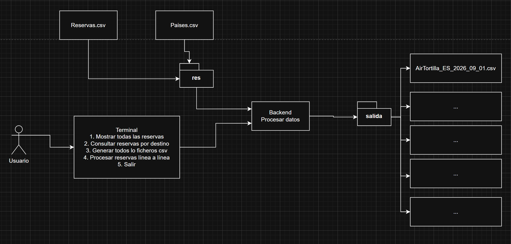

# AirTortilla - Gestión de reservas

## 1. Descripción del proyecto y diagrama

AirTortilla es una aplicación desarrollada en Java que permite gestionar reservas de pasajeros mediante ficheros CSV.

El objetivo principal es leer un fichero con las reservas y distribuirlas en diferentes archivos según el país de destino y la fecha en la que se realizó cada reserva.

La aplicación funciona por terminal y permite consultar las reservas, generar todos los archivos de salida de una vez o procesarlas individualmente, confirmando cada reserva mediante la tecla Enter.



## 2. Tecnologías utilizadas

- **Java:** lenguaje de programación utilizado para desarrollar la aplicación.
- **Maven:** gestión de la estructura y configuración del proyecto Java.
- **CSV:** formato utilizado para almacenar las reservas y los códigos de los países.
- **Terminal:** interfaz para interactuar con la aplicación.

No se necesita una base de datos ni servicios externos para ejecutar el programa.

## 3. Estructura de archivos

La estructura del proyecto es la siguiente:

```text
AirTortilla/
├── AirTortilla/
│   ├── src/
│   │   └── main/
│   │       └── java/
│   │           └── org/
│   │               └── AirTortilla/
│   │                   ├── Main.java
│   │                   ├── Reserva.java
│   │                   └── GestorReservas.java
│   ├── pom.xml
│   └── ...
├── res/
│   ├── Reservas.csv
│   └── Paises.csv
├── salida/
└── .gitignore
```

### Descripción de los archivos

- **Main.java:** muestra el menú de terminal y permite seleccionar las operaciones disponibles.
- **Reserva.java:** representa una reserva y almacena sus datos.
- **GestorReservas.java:** se encarga de leer los CSV, consultar las reservas, obtener los códigos de país y generar los archivos de salida.
- **Reservas.csv:** contiene las reservas que debe procesar la aplicación.
- **Paises.csv:** relaciona los nombres de los países con sus códigos ISO de dos letras.
- **salida/:** carpeta donde se generan los archivos CSV con las reservas clasificadas.
- **pom.xml:** contiene la configuración del proyecto Maven.

Las carpetas `res` y `salida` se encuentran fuera del proyecto Maven, al mismo nivel que la carpeta interior `AirTortilla`.

## 4. Formato del fichero de entrada: Reservas.csv

El fichero `res/Reservas.csv` contiene las reservas que se van a procesar.

Cada fila representa una reserva y utiliza cinco campos separados por comas.

| Campo | Descripción |
|---|---|
| `Destino` | País al que viaja el pasajero. |
| `Origen` | País desde el que parte el pasajero. |
| `NombrePasajero` | Nombre completo del pasajero. |
| `FechaReserva` | Fecha de realización de la reserva, en formato `YYYY-MM-DD`. |
| `Localizador` | Identificador único de la reserva. |

### Ejemplo de Reservas.csv

```csv
Destino,Origen,NombrePasajero,FechaReserva,Localizador
Francia,España,Ana García,2026-10-10,AT000001
Francia,España,Ana García,2026-10-10,AT000002
Francia,España,Ana García,2026-10-10,AT000003
Francia,España,Ana García,2026-10-10,AT000004
Francia,España,Ana García,2026-10-10,AT000005
Italia,España,Carlos López,2026-10-11,AT000006
Italia,España,Carlos López,2026-10-11,AT000007
España,Portugal,María Pérez,2026-10-12,AT000008
España,Portugal,María Pérez,2026-10-12,AT000009
Portugal,Francia,Laura Martín,2026-10-12,AT000010
```

### Reglas del formato

- La primera fila debe contener los nombres de las columnas.
- Cada reserva debe ocupar una línea.
- La fecha debe utilizar el formato `YYYY-MM-DD`, por ejemplo, `2026-10-10`.
- El localizador debe ser único para cada reserva.
- El país de destino debe estar registrado en `Paises.csv`.
- Los campos deben estar separados por comas y no deben quedar vacíos.

Las reservas pueden coincidir en nombre, origen y destino. El localizador permite distinguirlas de manera inequívoca.

En el ejemplo, las cinco primeras reservas corresponden a la misma persona y comparten origen, destino y fecha, pero cada una tiene un localizador diferente.

## 5. Formato del fichero de países: Paises.csv

El fichero `res/Paises.csv` contiene la relación entre cada país y su código ISO 3166-1 alpha-2.

Este fichero permite obtener el código del país de destino sin tener que modificar el código Java cuando se añade un país nuevo.

### Ejemplo de Paises.csv

```csv
Pais,CodigoISO
España,ES
Francia,FR
Italia,IT
Portugal,PT
Alemania,DE
Reino Unido,GB
Irlanda,IE
Países Bajos,NL
Bélgica,BE
Suiza,CH
Noruega,NO
```

### Reglas del formato

- La primera fila contiene las columnas `Pais` y `CodigoISO`.
- Cada país debe aparecer una sola vez.
- El código debe tener dos letras mayúsculas.
- El código debe corresponder a un código ISO válido.
- Los países utilizados en `Reservas.csv` deben estar registrados en este fichero.

Por ejemplo, si una reserva tiene como destino `Francia`, la aplicación obtiene el código `FR`.

Si el destino no está registrado, el programa informa del error en lugar de generar un archivo con un código desconocido.

**Nota:** los códigos ISO de dos letras identifican países. No son códigos IATA de países, aunque el enunciado utilice ese término.

## 6. Formato de los archivos de salida

Los archivos se generan dentro de la carpeta `Salidas/`.

El nombre de cada archivo sigue el formato:

```text
AirTortilla_XX_YYYY_MM_DD.csv
```

Donde:

- `AirTortilla` es el nombre de la aplicación.
- `XX` es el código ISO de dos letras del país de destino.
- `YYYY` representa el año de la reserva.
- `MM` representa el mes de la reserva.
- `DD` representa el día de la reserva.
- `.csv` es la extensión del fichero.

La fecha utilizada corresponde a la fecha de realización de la reserva, no a la fecha de ejecución del programa.

### Ejemplos de archivos generados

```text
Salidas/
├── AirTortilla_FR_2026_10_10.csv
├── AirTortilla_IT_2026_10_11.csv
├── AirTortilla_ES_2026_10_12.csv
├── AirTortilla_PT_2026_10_12.csv
├── AirTortilla_DE_2026_10_13.csv
└── AirTortilla_IT_2026_10_13.csv
```

Se genera un archivo por cada combinación de país de destino y fecha de reserva. Por tanto, un mismo país puede tener varios archivos si existen reservas de fechas diferentes.

### Ejemplo del contenido de un archivo de salida

Archivo `AirTortilla_FR_2026_10_10.csv`:

```csv
Destino,Origen,NombrePasajero,FechaReserva,Localizador
Francia,España,Ana García,2026-10-10,AT000001
Francia,España,Ana García,2026-10-10,AT000002
Francia,España,Ana García,2026-10-10,AT000003
Francia,España,Ana García,2026-10-10,AT000004
Francia,España,Ana García,2026-10-10,AT000005
```

El archivo conserva todos los campos de las reservas originales y mantiene los localizadores para poder identificar individualmente a cada pasajero y reserva.

## 7. Funcionamiento de la aplicación

Al ejecutar `Main.java`, aparece un menú de terminal con las siguientes opciones:

```text
========== AirTortilla ==========
1. Mostrar todas las reservas
2. Consultar reservas por destino
3. Generar todos los ficheros CSV
4. Procesar reservas línea a línea
5. Salir
Selecciona una opción:
```

### Opción 1. Mostrar todas las reservas

Lee el fichero `Reservas.csv` y muestra todas las reservas por terminal, incluyendo su localizador, nombre, origen, destino y fecha.

### Opción 2. Consultar reservas por destino

Solicita al usuario un país de destino y muestra las reservas que coinciden con él.

La búsqueda no distingue entre mayúsculas y minúsculas.

### Opción 3. Generar todos los ficheros CSV

Procesa todas las reservas automáticamente.

La aplicación lee el fichero completo, agrupa las reservas por país de destino y fecha, y genera los archivos correspondientes en `salida/`.

Esta modalidad está pensada para procesar todas las reservas sin intervención del usuario entre una y otra.

### Opción 4. Procesar reservas línea a línea

Procesa las reservas de forma interactiva.

El funcionamiento es el siguiente:

1. Lee la siguiente reserva del fichero.
2. Muestra sus datos por terminal.
3. Espera a que el usuario pulse Enter.
4. Guarda la reserva en el archivo de salida correspondiente.
5. Continúa con la siguiente reserva.

El proceso se repite hasta que se han procesado todas las reservas.

Esta modalidad permite revisar cada reserva antes de guardarla y observar cómo se van generando los archivos.

### Opción 5. Salir

Finaliza la ejecución de la aplicación.

## 8. Ejecución del proyecto

### Requisitos

- Tener instalado un JDK compatible con la versión de Java configurada en `pom.xml`.
- Disponer de Maven o ejecutar el proyecto desde un IDE compatible, como IntelliJ IDEA.
- Tener preparados los ficheros `res/Reservas.csv` y `res/Paises.csv`.

### Pasos para ejecutar

1. Abrir el proyecto Maven `AirTortilla` en IntelliJ IDEA.
2. Comprobar que los dos CSV están en la carpeta `res`, situada al nivel de la carpeta del proyecto Maven.
3. Comprobar que el directorio de trabajo de la configuración de ejecución apunta a la carpeta interior `AirTortilla`, donde se encuentra `pom.xml`.
4. Ejecutar la clase `Main.java`.
5. Seleccionar la operación deseada en el menú de terminal.
6. Consultar los archivos generados en la carpeta `Salidas`.

Las rutas relativas utilizadas por la aplicación dependen del directorio de trabajo. Si se ejecuta desde otra ubicación, deben ajustarse para que los ficheros de entrada y salida se encuentren correctamente.

## 9. Gestión de errores y limitaciones

La aplicación contempla algunos errores básicos:

- Ficheros de entrada inexistentes o inaccesibles.
- Filas con un número incorrecto de campos.
- Campos obligatorios vacíos.
- Fechas que no respetan el formato esperado.
- Destinos que no están registrados en `Paises.csv`.
- Países duplicados en el fichero de configuración.

Es importante mantener los formatos CSV indicados para que la lectura funcione correctamente.

La implementación actual utiliza comas como separador y no admite todos los casos del estándar CSV, como campos que contienen comas entre comillas. Además, el formato de los códigos de país se valida por su estructura, pero la correspondencia con los códigos oficiales depende de los datos incluidos en `Paises.csv`.

En las modalidades de generación, los archivos CSV anteriores de la carpeta `Salidas` se eliminan antes de comenzar el procesamiento. Por tanto, cada ejecución genera los resultados desde cero.

## 10. Resumen

AirTortilla permite gestionar las reservas mediante ficheros CSV y distribuirlas automáticamente según el país de destino y la fecha de realización de la reserva.

La aplicación dispone de una interfaz de terminal para consultar los datos, generar todos los archivos o procesar las reservas individualmente. El uso de localizadores únicos permite distinguir reservas coincidentes, mientras que el fichero `Paises.csv` facilita la incorporación de nuevos destinos sin modificar el código fuente.

---
# Segunda Entrega
---
## 11. Nueva versión web con base de datos

La nueva iteración añade una aplicación web sencilla. El backend usa Java 21, Spring Boot y MySQL; el front utiliza HTML, CSS y JavaScript nativo.

### Arranque con Docker

Requisitos: Docker Desktop con Docker Compose y los ficheros `res/Reservas.csv` y `res/Paises.csv`.

1. Copia `.env.example` a `.env` y cambia las contraseñas de base de datos y administrador.
2. Desde la carpeta raíz del proyecto, ejecuta `docker compose up --build`.
3. Abre [http://localhost:8080](http://localhost:8080) e inicia sesión con `ADMIN_USERNAME` y `ADMIN_PASSWORD`.

MySQL guarda los datos en el volumen `mysql_data`. La primera vez que arranca la aplicación importa los dos CSV si las tablas de países y reservas están vacías. Los siguientes arranques no vuelven a importarlos. Para repetir la importación desde cero, elimina el volumen con `docker compose down -v` (esto borra los datos guardados en la base de datos).

Para crear de nuevo el esquema tendrás que recrear la base de datos con `docker compose down -v` y después `docker compose up --build`. Esto elimina los datos del volumen; las reservas y países originales volverán a importarse desde los CSV.

### Funciones web

- Inicio y cierre de sesión.
- Tras iniciar sesión aparece un menú principal con botones que llevan a páginas independientes para ver reservas, filtrar por destino, generar CSV y añadir registros. La tabla no se carga en la página de inicio.
- Listado de reservas y consulta por destino.
- Alta de reservas con destino existente y localizador único.
- Descarga de un ZIP con los CSV agrupados por código ISO del destino y fecha de reserva.
- Alta de usuarios con rol de empleado o administrador. Solo administradores pueden crear usuarios y consultar la auditoría.
- Auditoría de altas de reservas y usuarios con usuario responsable, acción, identificador afectado y fecha.

La interfaz está servida por el mismo backend para simplificar el despliegue.


### Migración de CSV

Los CSV de entrada se montan en el contenedor como solo lectura en `/data/csv`. La importación inicial conserva destino, origen, nombre del pasajero, fecha y localizador; el destino se relaciona con la tabla de países. Los ficheros deben usar la cabecera y el formato que ya utiliza el proyecto. La aplicación falla al importar una fila inválida, en lugar de iniciar con una migración parcial.

### Ejecución local

Con MySQL disponible y Java 21 y Maven instalados:

```powershell
$env:SPRING_DATASOURCE_URL = "jdbc:mysql://localhost:3307/airtortilla?useSSL=false&allowPublicKeyRetrieval=true&serverTimezone=UTC"
$env:SPRING_DATASOURCE_USERNAME = "airtortilla"
$env:SPRING_DATASOURCE_PASSWORD = "<contraseña de la base de datos>"
$env:ADMIN_USERNAME = "admin"
$env:ADMIN_PASSWORD = "<contraseña del administrador>"
$env:CSV_DIR = "../res"
cd AirTortilla
mvn spring-boot:run
```

El administrador inicial solo se crea si `ADMIN_USERNAME` y `ADMIN_PASSWORD` están configurados y el nombre todavía no existe.

### API principal

- `POST /api/auth/login`, `GET /api/auth/me`, `POST /api/auth/logout`
- `GET /api/reservas` y `GET /api/reservas?destino=Francia`
- `POST /api/reservas`
- `GET /api/reservas/csv`
- `POST /api/users` (administrador)
- `GET /api/audit` (administrador)

Las reservas nuevas requieren `destino`, `origen`, `nombrePasajero`, `fechaReserva` (`YYYY-MM-DD`) y `localizador`. Las cuentas nuevas requieren `username`, `password` (mínimo 8 caracteres) y `role` (`EMPLEADO` o `ADMINISTRADOR`).

## 12. Archivos del front y estructura de MySQL

### ¿Por qué HTML, CSS y JavaScript están dentro del proyecto Java?

El front está en `AirTortilla/src/main/resources/static`. Spring Boot publica automáticamente esos archivos estáticos y la API bajo el mismo servidor y puerto. Así se puede arrancar el front y el backend juntos en Docker y el navegador puede llamar a la API sin configurar otro servidor web ni CORS. Si el front creciera o necesitara herramientas de compilación propias, podría separarse a otro proyecto; para este front básico, mantenerlo junto al backend simplifica el despliegue.

### Scripts SQL

En `database/01_schema.sql` está el esquema explícito de MySQL: `paises`, `reservas`, `usuarios` y `auditoria`, con claves primarias, relaciones y restricciones de unicidad. `database/02_import_csv.sql` carga los países y las reservas desde los CSV usando `LOAD DATA LOCAL INFILE`.

Al iniciar la aplicación, Hibernate crea o actualiza las tablas y `InitialData` importa los CSV automáticamente si países y reservas están vacíos. Para el uso habitual con Docker no hace falta ejecutar los scripts SQL. El script de importación es una alternativa manual.

### Ver las tablas con MySQL Workbench

1. Con la aplicación levantada, crea una conexión MySQL en Workbench con host `127.0.0.1`, puerto `3307`, usuario `airtortilla` y la contraseña `DB_PASSWORD` configurada en `.env`.
2. Selecciona el esquema `airtortilla` y expande **Tables** para ver sus tablas.
3. Haz clic derecho en una tabla y elige **Select Rows - Limit 1000** para ver los datos. Para ver columnas y tipos, usa **Table Inspector** o ejecuta `DESCRIBE reservas;` en una pestaña SQL.

